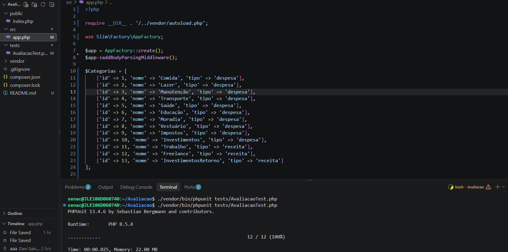

# API de Controle Financeiro

Nome: Davi Salvador Schubert  
Curso: Informática para Internet  
UC: Desenvolver Serviços Web

Esse projeto individual se baseia em uma API de controle financeiro, capaz de cadastrar, pesquisar, atualizar e deletar categorias e lançamentos financeiros, além de consultar o saldo e gerar resumos de movimentações por período.

Foram utilizadas as tecnologias:

- PHP
- Slim Framework
- Composer
- JSON
- PHPUnit

Para clonar esse projeto, você deve entrar no aplicativo Windows PowerShell e digitar:

```bash
git clone https://github.com/OTalDavi/AtividadeAvaliativa.git
```

Para instalar as dependências deste projeto, você deve entrar no terminal do VSCode ou Windows PowerShell e digitar:

```bash
composer install
```

Para executar este projeto, você deve entrar no terminal e digitar:

```bash
php -S localhost:8080 -t public
```

# Testes do projeto

**GET /status**

URL: localhost:8080/status

Objetivo: Verificar se o status da API está funcionando corretamente.

Ex. de Requisição: GET /status

Ex. de Resposta:
```json
{
  "status": "ok"
}
```

**GET /categorias**

URL: localhost:8080/categorias

Objetivo: Pesquisar todas as categorias cadastradas.

Ex. de Requisição: GET /categorias

Ex. de Resposta:
```json
[
  {
    "id": 1,
    "nome": "Alimentação",
    "tipo": "despesa"
  },
  {
    "id": 2,
    "nome": "Salário",
    "tipo": "receita"
  }
]
```

**GET /categorias/1**

URL: localhost:8080/categorias/1

Objetivo: Pesquisar a categoria cadastrada com id 1.

Ex. de Requisição: GET /categorias/1

Ex. de Resposta:
```json
{
  "id": 1,
  "nome": "Alimentação",
  "tipo": "despesa"
}
```

**POST /categorias**

URL: localhost:8080/categorias

Objetivo: Cadastrar uma nova categoria.

Ex. de Requisição:
```json
{
  "nome": "Pets",
  "tipo": "despesa"
}
```

Ex. de Resposta:
```json
{
  "id": 3,
  "nome": "Pets",
  "tipo": "despesa"
}
```

**PUT /categorias/1**

URL: localhost:8080/categorias/1

Objetivo: Atualizar a categoria cadastrada com id 1.

Ex. de Requisição:
```json
{
  "nome": "Mercado",
  "tipo": "despesa"
}
```

Ex. de Resposta:
```json
{
  "id": 1,
  "nome": "Mercado",
  "tipo": "despesa"
}
```

**DELETE /categorias/1**

URL: localhost:8080/categorias/1

Objetivo: Deletar a categoria cadastrada com id 1, desde que não existam lançamentos vinculados a ela.

Ex. de Requisição: DELETE /categorias/1

Ex. de Resposta: 
```json
{
  "mensagem": "Categoria excluída com sucesso"
}
```

**GET /lancamentos**

URL: localhost:8080/lancamentos

Objetivo: Pesquisar todos os lançamentos financeiros cadastrados.

Ex. de Requisição: GET /lancamentos

Ex. de Resposta:
```json
[
  {
    "id": 1,
    "descricao": "Ração",
    "valor": 85.50,
    "data": "2024-06-20",
    "tipo": "despesa",
    "categoria_id": 1
  },
  {
    "id": 2,
    "descricao": "Salário",
    "valor": 2500.00,
    "data": "2024-06-05",
    "tipo": "receita",
    "categoria_id": 2
  }
]
```

**GET /lancamentos/1**

URL: localhost:8080/lancamentos/1

Objetivo: Pesquisar o lançamento cadastrado com id 1.

Ex. de Requisição: GET /lancamentos/1

Ex. de Resposta:
```json
{
  "id": 1,
  "descricao": "Ração",
  "valor": 85.50,
  "data": "2024-06-20",
  "tipo": "despesa",
  "categoria_id": 1
}
```

**POST /lancamentos**

URL: localhost:8080/lancamentos

Objetivo: Cadastrar um novo lançamento financeiro.

Ex. de Requisição:
```json
{
  "descricao": "Ração",
  "valor": 85.50,
  "data": "2024-06-20",
  "tipo": "despesa",
  "categoria_id": 1
}
```

Ex. de Resposta:
```json
{
  "id": 3,
  "descricao": "Ração",
  "valor": 85.50,
  "data": "2024-06-20",
  "tipo": "despesa",
  "categoria_id": 1
}
```

**PUT /lancamentos/1**

URL: localhost:8080/lancamentos/1

Objetivo: Atualizar o lançamento cadastrado com id 1.

Ex. de Requisição:
```json
{
  "descricao": "Ração para cachorro",
  "valor": 95.00,
  "data": "2024-06-20",
  "tipo": "despesa",
  "categoria_id": 1
}
```

Ex. de Resposta:
```json
{
  "id": 1,
  "descricao": "Ração para cachorro",
  "valor": 95.00,
  "data": "2024-06-20",
  "tipo": "despesa",
  "categoria_id": 1
}
```

**DELETE /lancamentos/1**

URL: localhost:8080/lancamentos/1

Objetivo: Deletar o lançamento cadastrado com id 1.

Ex. de Requisição: DELETE /lancamentos/1

Ex. de Resposta:
```json
{
  "mensagem": "Lançamento excluído com sucesso"
}
```

**GET /resumo/saldo**

URL: localhost:8080/resumo/saldo

Objetivo: Consultar o total de receitas, despesas e o saldo atual.

Ex. de Requisição: GET /resumo/saldo

Ex. de Resposta:
```json
{
  "receitas": 2500.00,
  "despesas": 85.50,
  "saldo": 2414.50
}
```

**GET /resumo/periodo**

URL: localhost:8080/resumo/periodo?data_inicio=2024-06-01&data_fim=2024-06-30

Objetivo: Consultar o resumo financeiro de um período específico, informando a data inicial e a data final.

Ex. de Requisição:
GET /resumo/periodo?data_inicio=2024-06-01&data_fim=2024-06-30

Ex. de Resposta:
```json
{
  "data_inicio": "2024-06-01",
  "data_fim": "2024-06-30",
  "receitas": 2500.00,
  "despesas": 85.50,
  "saldo": 2414.50
}
```

# Filtros de lançamentos

Também é possível pesquisar lançamentos utilizando filtros por data, categoria e tipo.

Ex. de Requisição:

GET /lancamentos?data_inicio=2024-06-01&data_fim=2024-06-30&tipo=despesa&categoria_id=1

Objetivo: Pesquisar lançamentos de despesas da categoria 1 realizados entre 01/06/2024 e 30/06/2024.

# Regras aplicadas

- O valor do lançamento precisa ser maior que zero.
- A data deve existir e estar no formato AAAA-MM-DD.
- O tipo deve ser receita ou despesa.
- A categoria precisa existir e ter o mesmo tipo do lançamento.
- Não é permitido cadastrar duas categorias com o mesmo nome.
- Não é permitido excluir categorias que possuam lançamentos vinculados.
- Não é permitido alterar o tipo de uma categoria quando isso tornar lançamentos existentes incompatíveis.

# Testes automatizados

Para executar os testes do projeto, entre no terminal e digite:

```bash
vendor/bin/phpunit
```

